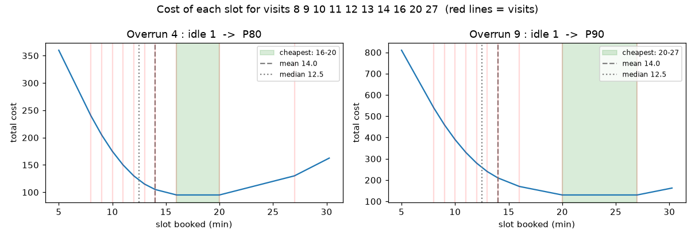

# A1 · Framing: what are we predicting, and how do we judge it?

> **Date:** 2026-10-08 · **Notebook:** [notebooks/A01_framing.ipynb](../notebooks/A01_framing.ipynb) · **Git tag:** `lesson-A1`
>
> **Interactive:** [OPD Slot Lab](https://claude.ai/artifact/9KwYwYZDJCDgN3XbP8vSLf) (Lab 1 slot cost, Lab 2 pinball loss, Lab 3 ask the PO). Offline copy: [interactive/index.html](interactive/index.html)

## In one line
The right slot isn't the average visit. It's the **quantile set by how much worse an overrun is than idle time**: overrun 4× worse means book the **P80**.

## Intuition

**Target.** We predict how long the **doctor is occupied**: `consult_end − consult_start`, in minutes. If "start" means check-in on some days and "doctor called patient" on others, the model learns that inconsistency as if it were real.

**Inputs.** Only what is known **at booking time**: doctor, clinic, day, time, new or follow-up, age, prior reports. Anything known only later (prescriptions written, how late the doctor runs that day) is **leakage**. It makes a model look great in tests and fail in production.

**Why not the average?** Consult times are **right-skewed**: mostly short, with occasional very long ones. Errors aren't symmetric either:
- slot too **short** → overrun, and the delay **cascades** to every later patient;
- slot too **long** → the doctor is idle once, and it doesn't spread.

So the best slot depends on the **cost ratio** between the two errors, and that ratio picks a **quantile**.

**The model's job:** predict a **conditional** quantile, a different P80 for each kind of appointment.

## Maths

### Quantile
$$
Q(q) = \min \{ v : P(y \le v) \ge q \}
$$
P50 (median) means half the visits finish within it; P80 means 80% do.

### The cost of a slot and its slope
$$
C(s) = \sum_i \Big[ c_{over}\,\max(y_i - s, 0) + c_{idle}\,\max(s - y_i, 0) \Big]
$$
$$
\frac{dC}{ds} = -\,c_{over}\, N_{above} + c_{idle}\, N_{below}
$$
Setting the slope to zero, with $F$ the fraction of visits below the slot:
$$
c_{idle}\,F = c_{over}(1-F) \quad\Rightarrow\quad \boxed{F = \frac{c_{over}}{c_{over}+c_{idle}}}
$$

| Symbol | Meaning |
|---|---|
| $y_i$ | actual length of visit $i$ (minutes) |
| $s$ | slot length booked |
| $c_{over}$ | cost per minute of overrun |
| $c_{idle}$ | cost per minute the doctor is idle |
| $N_{above}, N_{below}$ | number of visits longer / shorter than $s$ |
| $F$ | fraction of visits finishing within $s$, which is the quantile we should book |

### Pinball (quantile) loss
Divide the cost by $c_{over}+c_{idle}$ and set $q = \frac{c_{over}}{c_{over}+c_{idle}}$:
$$
L_q(y,\hat y) =
\begin{cases}
q\,(y-\hat y) & y \ge \hat y \quad\text{(under-predicted: ran over)}\\
(1-q)\,(\hat y-y) & y < \hat y \quad\text{(over-predicted: idle)}
\end{cases}
\;=\; \max\big(q(y-\hat y),\,(q-1)(y-\hat y)\big)
$$

### The loss decides the statistic
| Loss | Minimised by |
|---|---|
| $(y-\hat y)^2$ | mean |
| $\lvert y-\hat y \rvert$ | median ($q = 0.5$) |
| $L_q$ | $q$-th quantile |

**Worked example** with visits `8 9 10 11 12 13 14 16 20 27`:
- mean 14.0, median 12.5, P80 (numpy) 16.8, so the **slot is 20** (rounded up to 5 minutes)
- slope at $s=18$ with 4:1 costs: $-4\cdot 2 + 1\cdot 8 = 0$, so it's flat there
- one visit, $q=0.8$: 5 min over gives loss **4.0**; 5 min early gives loss **1.0**

## Code
| Piece | Where | Written by |
|---|---|---|
| `slot_cost(slot, durations)`, first as a loop, then vectorised with `np.maximum` | [A01_framing.ipynb](../notebooks/A01_framing.ipynb) | me |
| Data, plot, questions | same notebook | Claude |

## Our results
| Slot (min) | Cost (overrun 4 : idle 1) |
|---|---|
| 12 (≈ median) | 130 |
| 14 (mean) | 105 |
| 16 – 20 | **95 (minimum, flat)** |
| 25 | 120 |

- **4 : 1** → flat minimum from **16 to 20**; 8 of 10 visits lie at or below it, i.e. **80%**
- **9 : 1** → flat minimum from **20 to 27**; 9 of 10 visits lie at or below it, i.e. **90%**

## Gotchas
- I expected the median to be cheapest; the plot showed it wasn't. **Check your intuition against the plot.**
- When asked "what fraction lies below the flat region", count the visits, don't read the axis.
- Reading the flat region by eye undercounted it: it runs to 27, not 25. Check the edge values numerically.
- **Coverage below target means slots are too short**, not too long. 65% coverage means 35% of visits overrun, so patients wait. Too much idle time shows up as coverage *above* target (for example 95%). I got this backwards in the quick check.
- Coverage alone can be gamed: book 60 minutes and coverage is 100%. Always report it **with idle time**, or use the pinball loss.
- Quantile conventions differ between tools (16.8 vs 16 vs 20 for 10 points). This stops mattering with thousands of rows.

## How we'll score models
| Metric | Question it answers |
|---|---|
| MAE of P50 | How many minutes off is the typical guess? |
| Pinball loss of P80 | How good is the safe estimate, counting both kinds of error? |
| Coverage (share with $y \le$ P80) | Is our 80% really 80%? |
| Overrun rate, average idle minutes | What would the schedule feel like? |

**Success:** beat today's rule of **a fixed 15-minute slot for everyone**, with fewer overruns, less idle time, or both.

## Asking the business: questions for the PO

The 4:1 ratio is a **business decision**, not a maths one. Ask the product owner in plain words, with concrete minutes and no "costs" or "quantiles".

**Main question (the cost ratio):**
> "When an appointment runs over, the next patients wait and the doctor may finish late. When it finishes early, the doctor sits free until the next patient. Which is worse for us, and roughly by how much? Is 10 minutes of patients waiting about as bad as 10, 20, 40 or 90 minutes of the doctor sitting free?"

**Easier version (often simpler to answer):**
> "Out of every 10 appointments, how many are you OK with running past their booked slot?"

| PO says | Overrun : idle | Book |
|---|---|---|
| "5 out of 10 is fine" / "equally bad" | 1 : 1 | P50 |
| "2 out of 10" / "waiting is 4× worse" | 4 : 1 | **P80** |
| "1 out of 10" / "waiting is 9× worse" | 9 : 1 | P90 |

Translation rule: an answer of "N times worse" means book quantile $N/(N+1)$; "k out of 10 may run late" means book quantile $1 - k/10$.

**Follow-up questions (they reveal the real costs):**
1. What actually happens when a doctor runs late: overtime pay, complaints, patients leaving, bad reviews?
2. Can the doctor use free minutes (paperwork, calls, walk-ins)? If yes, idle time is cheap, so book a higher quantile.
3. Is it different by department, clinic or time of day? (A late running in the last slot means overtime; early in the day it cascades through the whole session.)
4. Do we promise patients anything, such as "seen within 15 minutes of your appointment time"?
5. Would you rather see more patients per day, or have fewer delays? (Throughput versus punctuality.)

**Show the trade-off with numbers.** For example: "Dr Deepak's typical new consult is about 13 minutes. Allowing 2 in 10 to run late means booking 20-minute slots; allowing 5 in 10 means 15-minute slots: 12 instead of 9 patients in a 3-hour session, but half of them start late."

### Checking our 4:1 assumption

Three ways to ask the PO whether 4:1 (P80) is right. **Ask question 3 first**: it describes what the schedule will feel like, which is easier to judge than a ratio. Then use question 1 to confirm the number.

1. **Direct:** "To save the next patients **1 minute** of waiting, would you accept the doctor sitting free for up to **4 minutes**?"
2. **At a scale people can picture:** "Over a session, would you accept about **40 minutes** of the doctor's free time if it saved patients **10 minutes** of waiting?"
3. **In outcomes:** "We're planning slots where about **2 out of every 10** appointments run past their time, and in the other 8 the doctor gets a few free minutes. Is that acceptable, or should fewer run late?"

| PO says | Meaning | Action |
|---|---|---|
| "Yes, that's about right" | 4:1 confirmed | Keep **P80** |
| "Free time doesn't matter much; waiting is what hurts" | Ratio higher than 4 | Move to **P90** (9:1) |
| "That's too much free time; doctors are expensive" | Ratio lower than 4 | Move to **P67** (2:1) or **P75** (3:1) |
| "It depends on the department or time of day" | Different ratios in different places | Ask for each case; we can use a different quantile per department |

### What the PO answered (2026-10-08)

| Question | Answer | What it tells us |
|---|---|---|
| 1. 4 min free to save 1 min waiting? | **No** | Overrun is **less** than 4× worse than idle |
| 2. 40 min free to save 10 min waiting? | **No** | Same: ratio below 4:1 (consistent with Q1, good) |
| 3. 2 in 10 running late acceptable? | **Maybe** | P80 is at the **edge** of acceptable, not comfortably inside it |

**Reading:** the true ratio is probably **2:1 to 3:1**, which means booking **P67 to P75**, a little below our assumed P80.

**Still to pin down:**
- "Would you accept **2** minutes free to save 1 minute of waiting? **3** minutes?" The first "yes" gives the ratio.
- "Would **3 in 10** running late be acceptable?" If yes, P70 is the target.

**Decision for the project:** treat **q as a setting, not a hard-coded 0.8**. Train models for several quantiles (0.67, 0.75, 0.8). In A8, show the PO a trade-off table from real predictions (overrun rate against idle minutes for each q) and let them choose. People judge real numbers more reliably than abstract ratios.

## Self-check

Q1. Why is the mean a bad slot for consult times?

The times are right-skewed and overruns cascade. The mean ignores the fact that running late costs more than idle time; the right slot is a quantile set by the cost ratio.

Q2. Overrun costs 3 per minute and idle costs 1. Which quantile should you book?

3 / (3 + 1) = **0.75**, so P75.

Q3. Why is the cost curve flat between 16 and 20?

Between those values the number of visits above (2) and below (8) the slot doesn't change, so the slope −4·2 + 1·8 = 0.

Q4. A model's P80 covers 95% of test visits. Is that good?

No. It's too generous: the doctor will be idle more than needed. Coverage should be close to 80%; check the idle minutes and the pinball loss.

Q5. Can "number of prescriptions written" be a feature?

No. It's only known after the visit. That's leakage.

Q6. Which loss makes a model predict the median?

Absolute error, i.e. the pinball loss with q = 0.5.

## In my words
- Consult times are right-skewed, and an overrun delays every patient after it, while a too-long slot only wastes a few minutes of the doctor's time.
- So we book the slot that balances the two costs, not the typical visit (P50), which would run late half the time.
- If an overrun is 4× worse than idle time, the balance point is 4/(4+1) = P80; a different ratio gives a different quantile.

## New terms
Target, feature, leakage, right-skewed, quantile, P50, P80, conditional quantile, pinball loss, coverage, MAE, baseline
