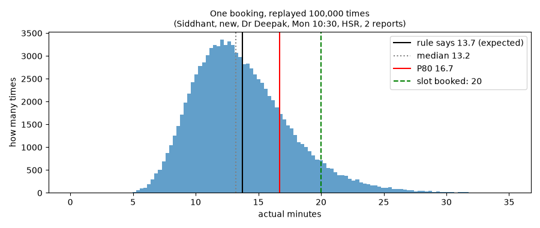
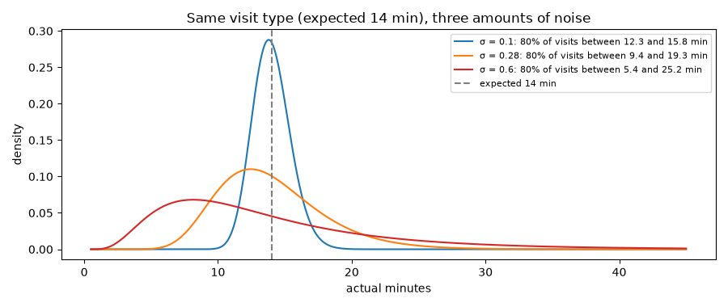
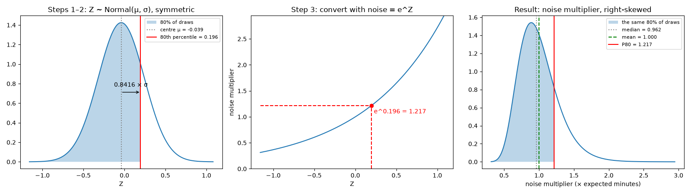
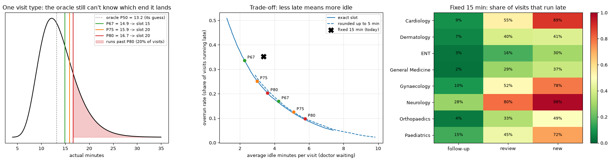

# A2 · Simulating the hospital (lifecycle stage 1: Collect)

> **Date:** 2026-10-08 · **Notebook:** [notebooks/A02_simulator.ipynb](../notebooks/A02_simulator.ipynb) · **Code:** [slotpred/world.py](../slotpred/world.py), [slotpred/simulate.py](../slotpred/simulate.py) · **Git tag:** `lesson-A2`

## In one line
**actual minutes = hidden rule × noise**: the rule is what a model can learn; the log-normal noise is what no model can know. Because we wrote both, we know the best score any model could reach.

## Start here: one visit, end to end

### The big picture: we are the game designer
In a video game, the **designer** writes the rules (how fast characters move, how dice rolls work). The **player** only sees the screen and has to work out the rules by playing.

| Game | This project |
|---|---|
| Designer, who writes the rules | **Us**: `world.py` decides how long consults take |
| Player, who sees only the screen | **The ML model**: sees only the EMR export (the CSV) |
| Grading the player | Because we wrote the rules, we can check whether the model found them |

In a real hospital nobody knows the rules. We simulate only because we have no real data, and as a bonus we get an **answer key**.

### Follow one visit through the simulator

**Step 1, the booking (facts).** `simulate.py` creates: Siddhant, 34, **new** visit, **Dr Deepak** (General Medicine), **Monday** 2 March, **10:30**, **HSR**, **2 prior reports**, no interpreter, not video. All of this is known when the receptionist books.

**Step 2, the rule (`expected_minutes`, which I wrote).**
```
work     = 12 (General Medicine, new) + 1.3 × 2 reports = 14.6
pace     = 0.94 (Monday; everything else is neutral, 1.0)
expected = 14.6 × 0.94 = 13.7 min
```
Meaning: *if this exact booking happened many times, it would take 13.7 minutes on average.*

**Step 3, the dice roll (`sample_noise`, which I wrote).** One random multiplier per visit. The same booking on ten different days:

| Day | 1 | 2 | 3 | 4 | 5 | 6 | 7 | 8 | 9 | 10 |
|---|---|---|---|---|---|---|---|---|---|---|
| Dice (noise) | 1.70 | 0.47 | 1.08 | 0.82 | 0.85 | 0.91 | 0.55 | 0.90 | 0.75 | 2.44 |
| Actual minutes (13.7 × dice) | 23.4 | 6.5 | 14.8 | 11.3 | 11.6 | 12.4 | 7.5 | 12.4 | 10.4 | 33.5 |

The dice is everything the booking form can't know: a worried patient, a new symptom, a chatty patient. A real visit gets **one** roll, say 1.08, giving **14.8 minutes**.

**Step 4, the clock.** An EMR doesn't store "14.8 minutes". It stores **timestamps**: the patient was called at 10:33:00 (3 minutes late), and the consult ended at 10:47:48. The duration (end − start) is something *we* compute in A4.

**Step 5, the export.** What leaves the hospital is the booking facts plus the timestamps. **Not** exported: 13.7 (the rule), 1.08 (the dice) and Dr Deepak's speed. The model must learn from rows like this.

```
booking facts ──► rule ──► 13.7 ──► × dice 1.08 ──► 14.8 min ──► timestamps ──► CSV row
 (exported)      (hidden)  (hidden)   (hidden)                    (exported)
```

### Replay that one booking 100,000 times



- **Same booking, very different lengths:** from about 6 to about 30 minutes.
- **The rule (13.7) is the average**, and the median (13.2) sits slightly to its left: the long right tail is the skew from A1.
- **P80 = 16.7, so the slot is 20.** Only **6.8%** of replays run past 20 minutes; **32.5%** would run past a fixed 15-minute slot.

**This picture is the whole of A1 and A2 in one chart.** For every kind of booking, the model's job is to learn where this hump sits (median) and where its 80% line is (P80). It can never know which bar *today's* visit will land in.

### The oracle: the rulebook, but no crystal ball
Imagine someone who has read `world.py` and knows the 13.7 exactly. Their best guess for a typical visit is the median, 13.2. But each day's dice still scatters the actual length, so on average they miss by **3.0 minutes**.

That's the **oracle's MAE**, the irreducible error. A model scoring about 3 minutes is close to perfect; no model can go lower, because nothing can predict the dice. A weather forecaster who understands the climate perfectly still can't promise exactly how much rain falls tomorrow.

### What each step of the notebook does
| Step | Question it answers |
|---|---|
| 2 Tests | Do my rule and dice behave as designed? |
| 3 Generate | Run steps 1–5 for 21 doctors × 8 months, about 44,000 visits |
| 4 Sanity checks | Does our fake hospital look like a real one? (skewed; departments in a sensible order; a July jump in Dermatology) |
| 5 Oracle | Best possible score vs today's fixed 15-minute slot |

### Map: story → file
| Story step | File |
|---|---|
| 1 Booking facts | [simulate.py](../slotpred/simulate.py): `_make_patients`, `_make_appointments` |
| 2 The rule | [world.py](../slotpred/world.py): `expected_minutes` |
| 3 The dice | [world.py](../slotpred/world.py): `sample_noise` |
| 4 The clock | [simulate.py](../slotpred/simulate.py): `consult_start`, `consult_end` |
| 5 Export (+ messy problems, spoiler) | `_messy_export.py` → `data/raw_emr_export.csv` |
| Answer key | `data/_hidden_truth.csv` (expected minutes, used only for the oracle) |

## Intuition

### Why simulate?
There's no real hospital data. A simulator also gives us something real projects never have: **the truth**. We can later check whether LightGBM found the rules (SHAP, A9), and we know the **oracle** score, the best any model could do.

### Rule + noise
```
actual minutes = expected_minutes(features) × noise
                 └──── the hidden rule ───┘   └ what no booking form can know ┘
```
The **noise** is everything the booking system can't see: a worried patient, a chatty patient, an unexpected finding.

### Additive or multiplicative? Ask: extra work, or a change of pace?

| Kind | Example | Formula | Meaning |
|---|---|---|---|
| **Additive** | Interpreter | m + 4 | A roughly fixed extra cost, short or long consult |
| **Multiplicative** | Slow doctor | m × 1.2 | 20% longer at everything: 10 → 12, 25 → 30 |

| Factor | Type | Size | Why |
|---|---|---|---|
| Base (department × visit type) | — | table in `world.py` | |
| Prior reports | Additive | +1.3 min each, at most 8 | Reading a report takes the same time in any consult; beyond 8 the doctor skims |
| Interpreter *(my choice)* | Additive | +4 min | Translating is a roughly fixed cost |
| Age 65+ *(my choice)* | Multiplicative | ×1.15 | Everything is slower: history, exam, explaining |
| Baby under 3 (Paediatrics) | Multiplicative | ×1.15 | Same idea as age |
| Teleconsult | Multiplicative | ×0.80 | No physical exam |
| Doctor's speed | Multiplicative | 0.85–1.35 | Personal pace applies to everything |
| Clinic | Multiplicative | 0.90–1.05 | Busy clinics run faster |
| Monday / Saturday | Multiplicative | ×0.94 / ×1.05 | Monday backlog; relaxed Saturday |
| Before 10:00 / from 16:00 | Multiplicative | ×1.05 / ×0.92 | Fresh morning; hurrying late afternoon |
| Dermatology from 1 July (**drift**) | Additive | +3 min | A fixed checklist |

**Order matters:** a slow doctor is slow at the extra work too, so the pace multiplies the reports and the interpreter time. The drift checklist is added *after* the pace, because it takes 3 minutes whoever the dermatologist is.

### Drift, built in on purpose
From **1 July** (the start of the test period): Dr Nikhil Verma joins Paediatrics (slow, never seen in training), and Dermatology adds +3 minutes. Training uses Jan–May and validation uses June, so neither change is visible until the test. That's what monitoring (A12) is meant to catch.

### What "multiplicative log-normal noise" means, word by word
- **Noise:** the random part no booking form can know.
- **Multiplicative:** the noise *scales* the expected time instead of adding to it.
  ```
  additive:        actual = expected + noise     (14 + 3)
  multiplicative:  actual = expected × noise     (14 × 1.2)
  ```
  ±3 minutes is huge for a 6-minute follow-up and tiny for a 24-minute neurology consult; ±20% is reasonable for both.
- **Log-normal:** draw $Z$ from a bell curve, then take $e^Z$.

| $Z$ drawn | noise $= e^Z$ | A 14-min visit becomes |
|---|---|---|
| −0.3 | 0.74 | 10.4 min (26% shorter) |
| 0 | 1.00 | 14.0 min |
| +0.3 | 1.35 | 18.9 min (35% longer) |
| +0.6 | 1.82 | 25.5 min |

Two consequences:
1. $e^Z$ is **always positive**, so a visit can never take negative minutes. Normal noise could produce that.
2. **Equal steps in $Z$ are unequal in minutes.** −0.3 shortens by 26%, +0.3 lengthens by 35%: short visits get squeezed, long ones stretched. That's the **right skew** from A1.

### Where σ = 0.28 comes from
It's an **assumption**, not data. It controls how much visits of the same kind vary:

| σ | 80% of visits expected to take 14 min fall between | Feels like |
|---|---|---|
| 0.10 | 12.3 and 15.8 min | Unrealistically regular, like a machine |
| **0.28** | **9.4 and 19.3 min** | Plausible: most visits close, some run long |
| 0.60 | 5.4 and 25.2 min | Very chaotic |



**With real data you measure σ instead of guessing it:** after fitting a model, compute $\log(\text{actual}) - \log(\text{predicted})$ for every visit; the standard deviation of those differences is σ. σ also sets the **oracle floor**: more noise means even a perfect model has a bigger error.

## Maths

### The rule
$$
\text{work} = \text{base} + 1.3\,\min(\text{reports}, 8) + 4\cdot[\text{interpreter}]
$$
$$
\text{pace} = f_{age}\, f_{infant}\, f_{tele}\, f_{doctor}\, f_{clinic}\, f_{day}\, f_{time}
$$
$$
\text{expected} = \text{work}\times\text{pace} + 3\cdot[\text{Dermatology and date} \ge \text{1 July}]
$$

### Log-normal noise
$$
Z \sim \mathcal{N}(\mu, \sigma^2), \qquad \text{noise} = e^{Z}, \qquad \text{actual} = \text{expected} \times \text{noise}
$$

| Quantity | Formula | σ = 0.28 |
|---|---|---|
| Mean of the noise | $e^{\mu + \sigma^2/2}$ | set to **1.000** |
| ⇒ centre of $Z$ | $\mu = -\sigma^2/2$ | **−0.039** |
| Median of the noise | $e^{\mu}$ | **0.962** |
| q-th quantile of the noise | $e^{\mu + z_q\,\sigma}$ | P80: $e^{0.196}$ = **1.217** |
| P80 ÷ median | $e^{z_{0.8}\,\sigma}$ | $e^{0.236}$ = **1.27** |

**Why μ = −σ²/2?** Because of the squeeze/stretch asymmetry, $e^Z$ averages slightly *above* 1 when $Z$ is centred at 0: the stretches outweigh the squeezes. Shifting the centre down by $\sigma^2/2 = 0.039$ cancels that exactly, so the noise averages 1.000 and doesn't secretly make every visit longer.

**Why is P80 about 27% above the median for every visit?** Because P80 ÷ median $= e^{\mu + z\sigma} / e^{\mu} = e^{z\sigma}$; μ and the expected minutes cancel out. The safety margin depends **only on σ**: more noise means a bigger margin.

### z-score
$$
z = \frac{\text{value} - \text{mean}}{\text{standard deviation}}
$$
How many standard deviations a value is from the mean. Example: heights average 165 cm with SD 10 cm, so 180 cm gives $z = (180-165)/10 = 1.5$.

Every normal distribution has the same shape when measured in SDs, so each $z$ marks a fixed share below it:

| $z$ | Share below it |
|---|---|
| 0 | 50% (median) |
| **0.8416** | **80%** |
| 1.2816 | 90% |
| 1.645 | 95% |

In Python: `scipy.stats.norm.ppf(0.8)` returns 0.8416.

### The P80 of the noise, step by step



1. **Left:** $Z$ is a symmetric bell centred at μ = −0.039 with spread σ = 0.28. Its 80th percentile is 0.8416 SDs above the centre: $-0.039 + 0.8416 \times 0.28 = 0.196$.
2. **Middle:** convert with $e^Z$. Go up from 0.196 and across: $e^{0.196} = 1.217$. The upward bend of the curve is what stretches the right tail.
3. **Right:** the noise is right-skewed. The **median (0.962) sits left of the mean (1.000)**, the skew from A1.

So 80% of visits finish within 1.217 × expected. A 15-minute expected visit: P80 = 18.3 min, so a **20-minute slot**.

**Key idea:** $e^Z$ only ever increases as $Z$ increases, so it never reorders the draws, and **percentiles carry straight across**: the 80th percentile of $e^Z$ is $e^{(\text{80th percentile of } Z)}$. **The mean doesn't carry across:** $e^{(\text{mean of } Z)} = e^{-0.039} = 0.962$ is the *median* of the noise, not its mean. That's exactly why μ had to be shifted by −σ²/2.

A million random draws confirm it: mean 1.000, median 0.962, P80 1.218.

**Worked example** (the sentence from the very first message): *Siddhant (34), new appointment with Dr Deepak (General Medicine, speed 1.0), Monday 10:30 at HSR, 2 reports.*
```
work     = 12 + 1.3 × 2 + 0      = 14.6
pace     = 1.0 × 1.00 × 0.94     = 0.94      (only Monday is not neutral)
expected = 14.6 × 0.94           = 13.7 min
median   = 13.7 × 0.962          = 13.2 min
P80      = 13.7 × 1.217          = 16.7 min   ->  20-min slot
```

## Code
| Piece | Where | Written by |
|---|---|---|
| Constants: departments, doctors, factors | [world.py](../slotpred/world.py) | Claude |
| `expected_minutes(...)`, the hidden rule | [world.py](../slotpred/world.py) | me (TODO) |
| `sample_noise(rng, n, sigma)` | [world.py](../slotpred/world.py) | me (TODO) |
| Calendar, patients, timestamps, export | [simulate.py](../slotpred/simulate.py) | Claude |
| Messy-data injection (**spoiler until A3**) | `_messy_export.py` | Claude |
| Behaviour tests | [tests/test_world.py](../tests/test_world.py) | Claude |
| The oracle | [A02_simulator.ipynb](../notebooks/A02_simulator.ipynb) | me (TODO) |

## Our results
- **Tests:** 18 passing (15 for `world.py`, 2 for the export, 1 setup). My first `expected_minutes` failed 7 tests (6 bugs); a missing boundary test let `age <= 3` slip through once more.
- **Data:** 43,747 visits Jan–Aug 2026; test period (Jul–Aug) 11,144 visits; average expected length 13.97 min.

### The oracle vs today's rule (test period, Jul–Aug)

The oracle knows `expected_minutes` (the rule) but never the noise. q is a setting: the PO rejected 4:1 (see A1), so all candidates are shown.

| | Fixed 15 | P67 exact | P67 rounded | P75 exact | P75 rounded | P80 exact | P80 rounded |
|---|---|---|---|---|---|---|---|
| MAE of P50 guess (min) | 5.77 | 3.08 | 3.08 | 3.08 | 3.08 | 3.08 | 3.08 |
| **Visits running late** | **35.2%** | 33.6% | 17.0% | 25.2% | 12.5% | 20.3% | 9.8% |
| Avg idle (min) | 3.37 | 2.27 | 4.24 | 3.00 | 5.12 | 3.60 | 5.77 |
| Avg late minutes | 2.40 | 1.10 | 0.57 | 0.80 | 0.41 | 0.63 | 0.32 |
| Avg slot (min) | 15.0 | 15.2 | 17.7 | 16.2 | 18.7 | 17.0 | 19.5 |



**Fixed 15: share of visits running late**

| | follow-up | review | new |
|---|---|---|---|
| Cardiology | 9% | 55% | 89% |
| Dermatology | 7% | 40% | 41% |
| ENT | 3% | 16% | 30% |
| General Medicine | 2% | 29% | 37% |
| Gynaecology | 10% | 52% | 78% |
| Neurology | 28% | 80% | 98% |
| Orthopaedics | 4% | 33% | 49% |
| Paediatrics | 15% | 45% | 72% |

### Answers to the notebook questions

**1. Oracle MAE = 3.08 min: the irreducible error.** My first answer called it "the minimum slot booking time"; it isn't a slot length. It is the smallest **average prediction error** any model can reach, because no model can know the noise. Closed form for log-normal noise:
$$
\text{MAE}_{oracle} = \text{expected} \times \big(2\Phi(\sigma) - 1\big) = 0.22 \times \text{expected} \quad(\sigma = 0.28)
$$
Average expected 13.97 min → 0.22 × 13.97 = **3.08**. Any real model (LightGBM in A6) scores **≥ 3.08**; today's rule scores 5.77. The floor grows with σ.

**2. Coverage.** The exact P80 slot covers **79.7%** (≈ 80%, up to sampling). Rounded up to 5 minutes it covers **90.2%**: rounding adds about **2.5 min** to each slot on average, buying coverage with idle time (3.6 → 5.8 min). **Consequence:** on a 5-minute grid, a lower q already meets the target. Rounded P67 lets only 17% run late, inside the PO's "2 in 10". (Alternative to discuss later: round to the *nearest* 5 instead of up.)

**3. Fixed 15 fits nobody.** 35% of visits run late. It's **too short for long visits** (Neurology new 98%, Cardiology new 89%, Gynaecology new 78%, Paediatrics new 72%) and **too long for short ones** (General Medicine follow-up 2% late, about 7 idle minutes). The exact oracle P67 books almost the same total time (15.2 min on average) but **halves the late minutes (1.1 vs 2.4) and cuts idle (2.3 vs 3.4)**. Prediction doesn't add time; it **moves time to the visits that need it**.

**4. Why P80 ≈ 1.27 × median for every visit.** $P80/\text{median} = e^{\mu + z\sigma}/e^{\mu} = e^{z\sigma} = e^{0.8416 \times 0.28} = 1.27$. The expected minutes and μ cancel, so the *relative* margin depends only on σ. In minutes it grows with the visit: 10 min → +2.7, 30 min → +8. For the PO's candidates: P75 → ×1.21, P67 → ×1.13.

### Step 5 code, explained

| Piece | What it does |
|---|---|
| `test = world[world["date"] >= TEST_START]` | Only July–August, the period every model is judged on |
| `expected_minutes * np.exp(-sigma**2/2)` | Oracle P50: the median of the noise is $e^{\mu}$ = 0.962 |
| `expected_minutes * np.exp(-sigma**2/2 + norm.ppf(q)*sigma)` | Oracle P_q: `norm.ppf(q)` is the z-score for q (0.44, 0.67, 0.84 for P67, P75, P80) |
| `np.ceil(p_q / 5) * 5` | Round **up** to the booking grid |
| `summarise(guess, slot)` | One scorecard for every booking rule; `.clip(lower=0)` keeps only the positive part, like `np.maximum(..., 0)` in A1 |
| Loop over `Q_CANDIDATES` | q is a business setting, never hard-coded |

**My Step 5 bug (leakage):** my first oracle multiplied `actual_minutes` instead of `expected_minutes`. It scored MAE 0.54 and 100% coverage, **too good to be true**. `actual_minutes` contains the noise, so the oracle was predicting each visit from its own outcome. Also, `sigma` was only defined in an earlier cell: hidden notebook state.

### Is the doctor's `speed` leakage? (my question)
**No, because it never leaves the simulator.** Leakage means the *model* uses information it won't have at prediction time. `speed` lives only in the hidden world; the export the model trains on ([_messy_export.py](../slotpred/_messy_export.py) column list) contains only the doctor's **name**, which *is* known at booking. A test, [tests/test_export.py](../tests/test_export.py), fails if any hidden column (`doctor_speed`, `expected_minutes`, `noise`, `actual_minutes`) ever appears in the export.

The real world works the same way: every doctor has a pace, but no system records it. The model has to **learn each doctor's pace from their past visits**, through the doctor feature. That's also why **Dr Nikhil Verma** (joins in July) is hard: no past visits, so no way to learn his pace. This is called a **cold start**.

**Where speed-related leakage *can* creep in (A4):** a feature such as "this doctor's median consult time" is legitimate **only if computed from visits before the one being predicted**. Computed over all data, including the visit itself or future visits, it leaks the answer.

| Data | Who sees it | Role |
|---|---|---|
| `world` (speed, expected minutes, noise) | Only us, for sanity checks and the oracle | The hidden truth |
| `raw_emr_export.csv` | The model | Everything a real hospital would hand over |

The oracle in the A2 notebook *does* use `expected_minutes`. That's fine, because it's a **benchmark** for the best possible score, never a model we deploy.

## Gotchas
- **Too good to be true means check for leakage.** My oracle used `actual_minutes` and scored MAE 0.54 with 100% coverage. The fix was `expected_minutes`.
- **Hidden notebook state:** a variable defined in another cell (`sigma`) works until the kernel restarts. Define what a cell needs inside that cell.
- **Rounding up to the grid adds about 2.5 min per slot**, which moves coverage from 80% to 90%. On a 5-minute grid, a lower q meets the same target.
- **Hidden truth ≠ feature.** Simulator internals (speed, expected minutes, noise) must never reach the training data. A test guards the export.
- **0.8416 is not a standard deviation.** It's a z-score: a count of SDs, the same for every normal distribution. The SD is **σ = 0.28** (the SD of $Z$, the *log* of the noise, not of the minutes). Distance to the 80th percentile = $0.8416 \times \sigma = 0.236$. Heights analogy: SD 10 cm, so the 80th-percentile height = 165 + 0.8416 × 10 = 173.4 cm.
- **Percentiles survive $e^Z$; the mean doesn't.** $e^{\text{mean of } Z}$ is the median of the noise, not its mean.
- σ is an **assumption** in a simulator. With real data, **measure** it from log residuals.
- The side chat's table said "6 and 30 min" for σ = 0.60; the exact values are 5.4 and 25.2. Check quick estimates numerically.

## Self-check

<details><summary>Q1. Why multiplicative noise rather than additive noise?</summary>

A long consult can go wrong by more minutes than a short one. ±20% suits both a 6-minute follow-up and a 24-minute consult; ±3 minutes doesn't. Multiplicative log-normal noise also can't go negative and is right-skewed.
</details>

<details><summary>Q2. Why μ = −σ²/2 and not μ = 0?</summary>

With μ = 0 the noise would average e^(σ²/2) ≈ 1.04, secretly making every visit 4% longer. μ = −σ²/2 makes the mean exactly 1.
</details>

<details><summary>Q3. With σ = 0.28, what's P80 ÷ median? Does it depend on the department?</summary>

e^(0.8416 × 0.28) ≈ 1.27, and no: the expected minutes cancel. Only σ matters.
</details>

<details><summary>Q4. What z-score has 90% of a normal distribution below it?</summary>

1.2816.
</details>

<details><summary>Q5. Interpreter: additive or multiplicative, and why?</summary>

Additive. Translating adds roughly the same minutes whatever the consult's length.
</details>

<details><summary>Q6. How would you estimate σ from real data?</summary>

Fit a model, take log(actual) − log(predicted) for every visit, and compute the standard deviation.
</details>

<details><summary>Q7. The doctor's speed isn't in real data. Is using it in the simulator leakage?</summary>

No. It's part of the hidden rule and never exported; the model sees only the doctor's name and must learn the pace from past visits. It would be leakage only if a hidden column reached the training data, or if a "doctor's average time" feature were computed using the visit being predicted or later visits.
</details>

## In my words
<!-- Siddhant: 3 lines, your own words. -->

## New terms
Simulator, hidden rule, noise, additive effect, multiplicative effect, log-normal, σ (sigma), z-score, oracle, irreducible error, drift
